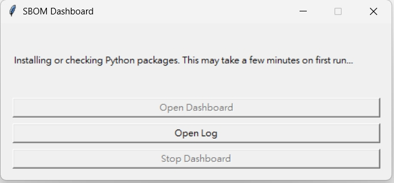
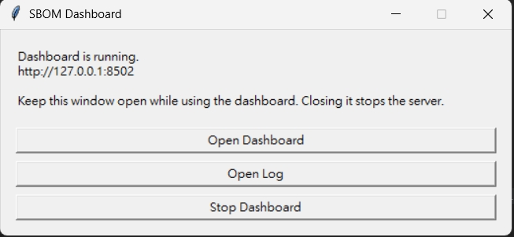
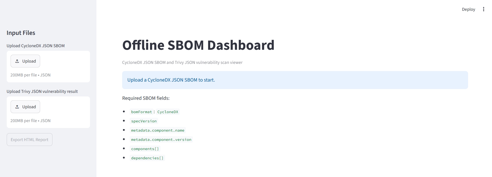

# Offline SBOM Dashboard

Windows 11 local dashboard for CycloneDX JSON SBOM review and Trivy JSON
vulnerability result review.

This tool is designed for MCU BSP / SDK SBOM analysis. It runs locally with
Python and Streamlit. It does not use Docker, does not use a database, and does
not require network access after Python packages are installed.

## What This Tool Does

- Load CycloneDX JSON SBOM files.
- Show product name, version, SBOM format, component count, dependency count,
  license count, and vulnerability summary.
- Show searchable component tables.
- Show component detail, license summary, and dependency graph.
- Load Trivy JSON vulnerability results when available.
- Export a standalone offline HTML report to `exports\`.
- Add a `How To Interpret This Report` section to exported HTML reports.

## Important Interpretation Rules

- Product SBOM should be used for product vulnerability assessment.
- Test Sample SBOM components are not product runtime dependencies unless they
  are explicitly reused, redistributed, or integrated.
- `Not scanned != Clean`.
- `N/A` in vulnerability fields means the vulnerability status is unknown or not
  provided. It does not mean zero vulnerabilities.
- The HTML report is a human-readable summary. It does not replace the original
  SBOM evidence package.

## Project Structure

```text
.
|-- app.py
|-- requirements.txt
|-- README.md
|-- run_dashboard.pyw
|-- run_dashboard.bat
|-- run_dashboard.jpg
|-- run_dashboard2.jpg
|-- offline_dashboard.jpg
|-- sample_data/
|   `-- README.md
|-- exports/
|   `-- .gitkeep
`-- templates/
    `-- report.html.j2
```

The structure above lists the delivered source files. Runtime-generated files
such as `.venv\`, `run_dashboard.log`, and exported `exports\*.html` reports may
also appear after using the dashboard. Do not include customer SBOM files,
generated reports, virtual environments, or logs when packaging this tool for
external delivery.

## Prerequisites

Install Python 3.10 or newer on Windows 11.

During Python installation, enable:

```text
Add python.exe to PATH
```

After installation, open Command Prompt or PowerShell and verify:

```bat
python --version
py -0p
```

Expected result: Python 3.10 or newer is listed.

## Recommended Start Method

For normal users, double-click:

```text
run_dashboard.pyw
```

The launcher creates or reuses `.venv`, checks Python packages, starts the local
Streamlit server, and opens the dashboard in the default browser.

On first run, the launcher may spend a few minutes installing or checking Python
packages:



During this step:

- `Open Dashboard` is disabled because the web server is not ready yet.
- `Open Log` can be used to inspect startup details.
- `Stop Dashboard` may be disabled until the server process is started.

After initialization finishes, the launcher shows the running server URL:



The launcher window means the local dashboard server is running. Keep this
window open while using the dashboard.

- `Open Dashboard`: opens or reopens the browser dashboard.
- `Open Log`: opens `run_dashboard.log` for troubleshooting.
- `Stop Dashboard`: stops the local Streamlit server.

Closing this launcher window also stops the dashboard server.

Do not double-click `app.py`. It is source code and Windows or an IDE may open
it as a text file.

## Troubleshooting Start Method

If the `.pyw` launcher fails or you need console output, double-click:

```text
run_dashboard.bat
```

This uses the same dashboard but keeps console messages visible.

## Manual Command Line Start

Run these commands from the dashboard directory:

```bat
python -m venv .venv
.venv\Scripts\activate
pip install -r requirements.txt
streamlit run app.py
```

Then open the URL printed by Streamlit, usually:

```text
http://localhost:8501
```

## Offline Package Installation

The dashboard runs locally after dependencies are installed. If the target PC is
fully offline, prepare packages on a PC that can access Python packages:

```bat
python -m pip download -r requirements.txt -d wheelhouse
```

Copy `wheelhouse\` to the offline PC, then install from the local folder:

```bat
.venv\Scripts\activate
pip install --no-index --find-links wheelhouse -r requirements.txt
```

## First Screen

After the launcher starts the server, the browser opens the dashboard.



On the first screen:

- `Upload CycloneDX JSON SBOM`: required input. Upload a CycloneDX JSON SBOM.
- `Upload Trivy JSON vulnerability result`: optional input. Upload valid Trivy
  JSON if vulnerability scan output is available.
- `Export HTML Report`: disabled until an SBOM is loaded.
- Main panel: shows required SBOM fields before a file is uploaded.

## How To Use The Dashboard

1. Start the dashboard with `run_dashboard.pyw`.
2. Upload a CycloneDX JSON SBOM in the browser sidebar.
3. Optionally upload a valid Trivy JSON vulnerability result.
4. Use the dashboard tabs to inspect the SBOM.
5. Click `Export HTML Report` in the sidebar to create a standalone HTML report
   in `exports\`.

## Dashboard Tabs

### Dashboard

Shows the high-level status of the loaded SBOM:

- Product name and version.
- SBOM format and CycloneDX version.
- Product SBOM / Test Sample SBOM / Unclassified SBOM scope.
- Total components, dependencies, licenses, and vulnerability counts.
- Component type distribution when component data is available.

Use this tab first to confirm that the correct SBOM was loaded and to check
whether the vulnerability status is known, unknown, or not scanned.

### Components

Shows a searchable and filterable component table.

Useful for:

- searching component name, PURL, or bom-ref
- filtering by component type
- filtering by license
- reviewing component detail
- checking hashes, external references, properties, and description
- seeing vulnerabilities mapped to a selected component

### Dependency Tree

Shows dependency relationships from CycloneDX `dependencies[]`.

Useful for:

- selecting a root component
- viewing direct dependencies
- viewing the full dependency graph
- confirming whether the SBOM describes dependency relationships

If the SBOM has no dependency relationships, the dashboard shows:

```text
No dependency relationship found in this SBOM
```

### Licenses

Summarizes license usage.

Useful for:

- seeing each declared license ID, license name, or license expression
- checking how many components use each license
- finding which components use a specific license

### Vulnerabilities

Shows vulnerability data only when a valid Trivy JSON result is loaded.

Useful for:

- viewing severity distribution
- filtering by Critical, High, Medium, Low, or Unknown
- filtering by package/component
- searching CVE ID, title, or package name
- reviewing description, CVSS, references, fixed version, and status

If no vulnerability data is available, the dashboard explains that no
vulnerabilities were found or no vulnerabilities were mapped. If a scan is not
scanned, treat it as unknown, not clean.

## Supported SBOM Input

CycloneDX JSON SBOM files are supported.

Common expected fields:

- `bomFormat`
- `specVersion`
- `metadata.component.name`
- `metadata.component.version`
- `components[]`
- `dependencies[]`

Example generic file names:

```text
Product_SBOM.cdx.json
TestSample_SBOM.cdx.json
SDK_SBOM.cdx.json
```

The tool is not hard-coded to any MCU vendor, MCU model, BSP, or SDK.

## Supported Trivy Input

Valid Trivy JSON vulnerability result files are supported.

Common expected fields:

- `Results[]`
- `Vulnerabilities[]`
- `VulnerabilityID`
- `PkgName`
- `InstalledVersion`
- `FixedVersion`
- `Severity`
- `Title`
- `Description`
- `PrimaryURL`
- `CVSS`
- `References`

If the uploaded Trivy file has no `Vulnerabilities`, the dashboard shows:

```text
No vulnerabilities found or no mapped vulnerabilities
```

If the scanner reports `Not scanned`, the dashboard and exported report should
be interpreted as:

```text
Not scanned != Clean
```

## HTML Report Export

After loading an SBOM, click:

```text
Export HTML Report
```

Reports are written to:

```text
exports\
```

The generated HTML is standalone and can be opened offline in a browser.

Each report includes:

- report title and generated time
- SBOM file name
- product name and version
- component summary
- license summary
- vulnerability severity summary
- component table
- vulnerability table when available
- `How To Interpret This Report`
- notes for `Not scanned != Clean`, Product SBOM, and Test Sample SBOM

## How To Read The Exported HTML Report

Start with `How To Interpret This Report`.

Then check:

- `Product Name` and `Product Version`: confirms which SBOM was loaded.
- `Product SBOM` / `Test Sample SBOM` / `Unclassified SBOM`: confirms intended
  assessment scope.
- `Total Components`: number of components in the loaded SBOM.
- `Total Dependencies`: dependency graph relationship count.
- `Total Licenses`: number of distinct declared license values.
- `Vulnerability Count`: actual count only when a valid Trivy JSON result was
  loaded and parsed.

If vulnerability fields show `N/A`, the correct conclusion is:

```text
Vulnerability status is unknown. N/A does not mean clean.
```

## Packaging Checklist

Before sharing this tool externally, include only the dashboard source package.

Do include:

- `app.py`
- `requirements.txt`
- `README.md`
- `run_dashboard.pyw`
- `run_dashboard.bat`
- `run_dashboard.jpg`
- `run_dashboard2.jpg`
- `offline_dashboard.jpg`
- `sample_data\README.md`
- `exports\.gitkeep`
- `templates\report.html.j2`

Do not include:

- customer or vendor SBOM files
- `customer_SBOM\`
- generated `exports\*.html` reports
- `.venv\`
- `run_dashboard.log`
- `wheelhouse\` unless intentionally providing offline dependencies
- `__pycache__\`

## Common Problems

### Double-clicking app.py opens a text editor

This is expected. `app.py` is source code. Use `run_dashboard.pyw` instead.

### The dashboard does not open

Try `run_dashboard.bat` and read the console output. Also check:

```text
run_dashboard.log
```

### Python is not found

Install Python 3.10 or newer and enable `Add python.exe to PATH`.

### pip install fails on an offline PC

Prepare a local `wheelhouse\` folder on an online PC and install with:

```bat
pip install --no-index --find-links wheelhouse -r requirements.txt
```

### Trivy upload fails

Confirm the file is valid JSON. Some files with `.json` extension may actually
contain a human-readable table or summary. Those files are not valid Trivy JSON
input for this dashboard.
